

  

From the splash page, or via the top menu users can access "Data Upload and Validation" or "Tumor Volume Analysis." 

# Data Upload and Validation

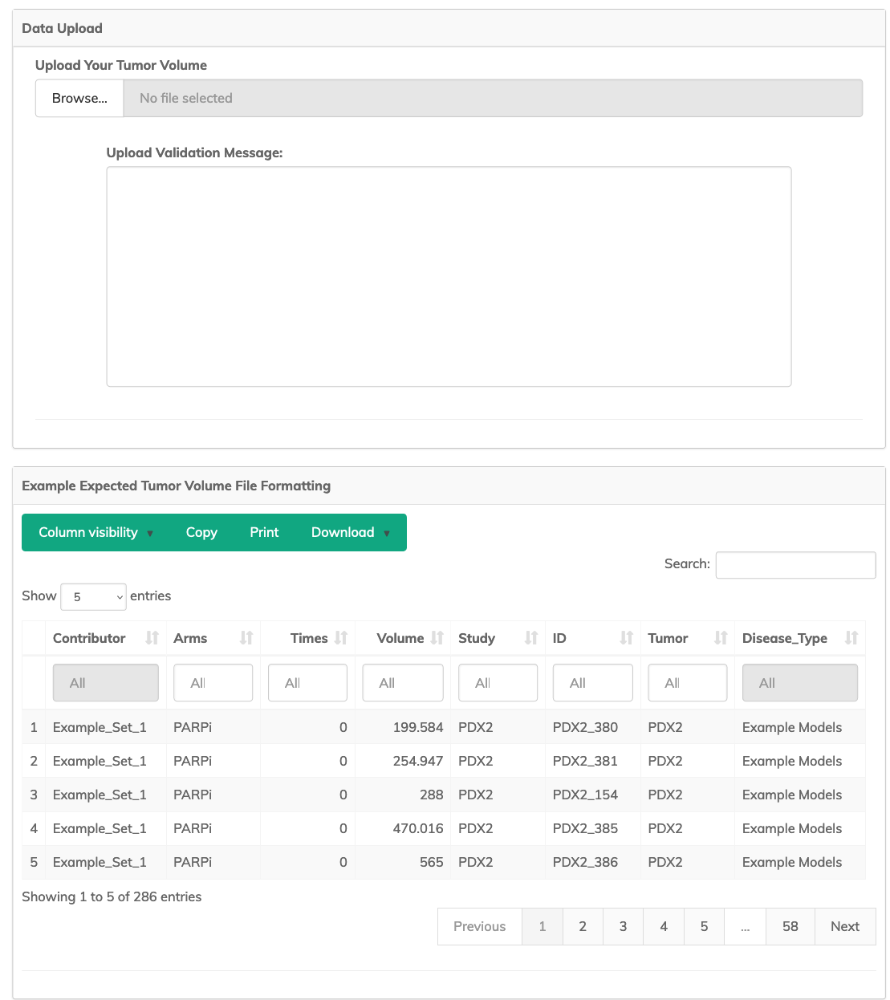

On this tab, you can upload your tumor volume data by clicking the 'browse' button and then selecting your file. Files are expected in either CSV or EXCEL format. Other formats are not accepted.  

Files uploaded to this tool must also contain expected columns and data structure as described in the following section: 

---

## Data Format and Structure

The following columns are required unless marked optional. Column names and data types must match exactly.

1. **Contributor** (character): Contributing investigator or institution, such as `PDTC_1`.
2. **Arms** (character): Treatment-arm label, such as `Carboplatin`. The dataset must contain a control arm named exactly `Control`.
3. **Times** (numeric or integer): Study day, such as `0`, `4`, `8`, `14`, or `21`. Calendar dates are not accepted.
4. **Volume** (numeric or integer): Tumor volume in mm3. Use nonnegative measurements. Some analyses exclude negative values, and the upload validator does not reliably warn about them.
5. **Study** (character): Study identifier. Study IDs should be unique across centers and samples.
6. **ID** (character or integer): Unique identifier for each animal; IDs should be unique across studies.
7. **Tumor** (character, numeric, or integer): PDX model identifier, such as `PDX_1`.
8. **Disease_Type** (character): Free-text tumor type, used by the data filter.
9. **Body_Weight** (optional, numeric or integer): Animal body weight. If omitted or empty, Body Weight Analysis is unavailable.
10. **Treatment_Components** (optional, character): Semicolon-separated list of active agents in the treatment arm, repeated on every measurement row (e.g., `Drug A;Drug B`). Leave empty for `Control`; keep each arm's component list consistent within a Contributor/Study/Tumor cohort. Do not use semicolons within an agent name. Dose-response analysis requires separate dose metadata and is not provided by the fixed-dose factorial analysis.

## Data Upload Template

An empty template with these file headers is available for download at the bottom of the Data Upload and Validation

## Upload Validation Message

Once you file is selected, a validator will run during the upload to ensure that all fields are present, and that each field contains the expected data type. 

If data are correctly formatted, a message 'Successfully Validated Your Tumor Volume Data!' will show that you successfully imported and loaded your data to the 'Tumor Volume Analysis' tab.  

If data are improperly formatted, the validator will list errors associated with the upload. Correct the errors in your local file, and retry the upload. 

## Example Formatted File

An example data table is provided on this page to show users the expected data structure and formatting. This table can be download for your reference. 

# Tumor Volume Analysis

The Tumor Volume Analysis page contains all plot and analysis functions.  

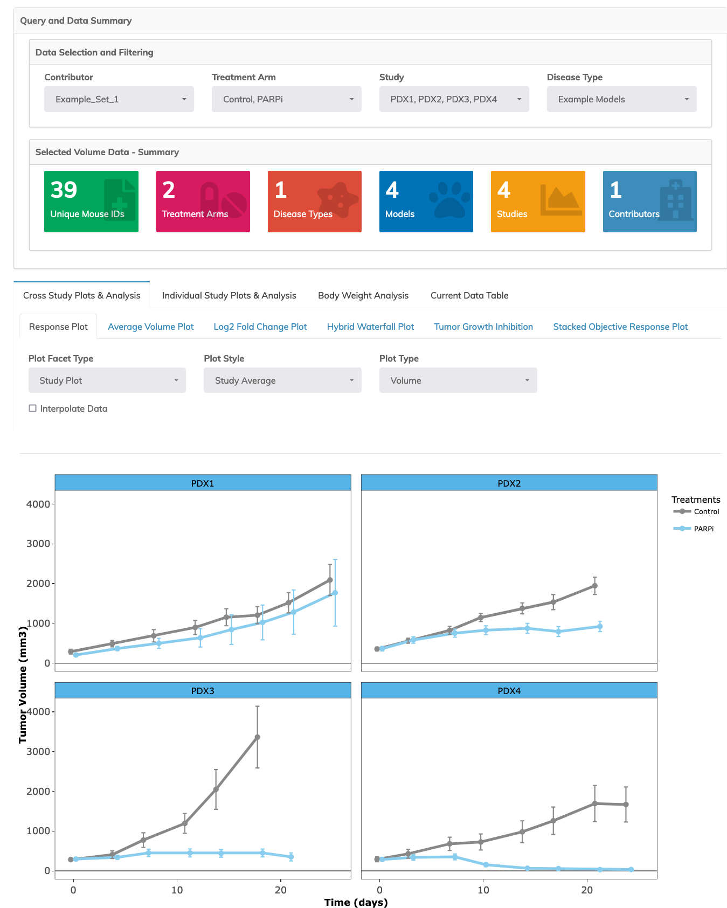

  

By default an example dataset is loaded. To add your own data, see the **Data Upload and Validation** section of this document. 

The default data includes a second contributor, `Example_Set_2`, with a synthetic 2 x 2 combination example. Select it in the Contributor filter. It contains control, Drug A, Drug B, and Drug A + Drug B arms, with `Treatment_Components` metadata. At day 21, the single agents each have about 2x fold growth while the combination has about 0.5x. Under an additive no-interaction model on log2 fold change, the expected combination has about 1x fold growth; this dataset is constructed to show a negative interaction. It is illustrative synthetic data, not experimental evidence.

---

## Calculation Day Information

Calculation-day handling depends on the analysis; the app does not use one universal rounding rule.

* Cohort RECIST and individual-animal response metrics use the closest available measurement for each animal when there is no exact measurement on the selected day. If the interpolation checkbox is enabled, those analyses use the interpolated series instead.
* T/C, endpoint ANOVA, and factorial interaction calculations linearly interpolate an animal's volume to the requested day when it is bracketed by measurements. They do not extrapolate. Animals without a measurement range spanning the selected day, or with a baseline volume at or below zero, are excluded from these endpoint calculations.
* Endpoint volume zero is retained. For log2 fold-change models, a zero fold change is floored to 0.001 before taking the logarithm.

Choose a calculation day that is scientifically relevant to the study. Report the selected day and whether full-series interpolation was enabled.

## Data Interpolation 

For analyses with an interpolation checkbox, data can be interpolated using the 'Interpolate Data' or 'Interpolate Data for Calculation' checkbox. T/C, endpoint ANOVA, and factorial interaction also interpolate to a requested day within the measurement range as described above, regardless of the checkbox. 

When a checkbox is enabled, linear interpolation fills missing days between flanking volume measurements at times *t*0 and *t*1, where *t*0 < *t* < *t*1. No extrapolation is performed.

---

# Query and Data Summary

## Data Selection and Filtering

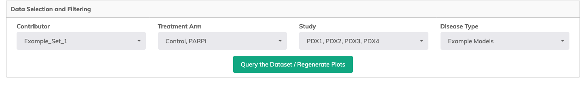

This section contains data query filters, which allows the user to select subsets of the loaded data set. For example, select which treatment arms you wish to visualize. 

**NOTE:** When selecting treatment arms, 'Control' **MUST** be selected, or plots and analysis metrics will not be generated. Likewise, if no data is selected, the tool will not function. 

After selections are made, clicking the 'Query Dataset / Regenerate Plots' will submit the data filtering query. 

--- 

## Selected Data Summary

This section summarized the selected data. The number of unique mouse IDs, treatment arms, disease types, models, studies, and contributors are shown. 

# Tumor Volume Analysis Pages

Below the data query and summary are three sub-tabs that allow users to access different plots and the filtered data table. 

1. Cross Study Plots and Analysis
2. Individual Study Plots & Analysis
3. Body Weight Analysis (if body weights provided)
4. Current Data Table

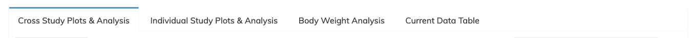

---

## Report Gen. and Figure Download

A report generated using all user selected options across all tabs (e.g., response plot facet type, individual study RECIST calculation day., etc.) can be created by clicking 'Generate Report' in the 'Tumor Volume Analysis' toolbar.  

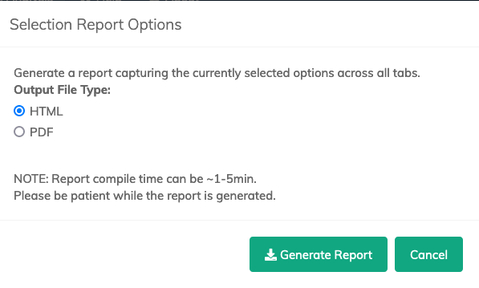

A pop-up window allows the user to select from either HTML or PDF style reports.  

Additionally, should a user require a single figure or plot, the 'Download plot as a png' plotly toolbar function can be used for all figures in the tool. 
To access this toolbar, hover your mouse over a figure and click the camera icon on the far left side of the plotly toolbar as shown in the image below. 

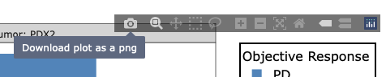

---

## Cross Study Plots and Analysis

The user selects from six tabs that provide access to different visualizations and analysis metrics for cross study comparisons. 

**NOTE:** Data filtering via 'Data Selection and Filtering' dropdowns can be used to select or deselect studies as needed.

  

**Individual plots and options are described below.**

---

### Response Plot

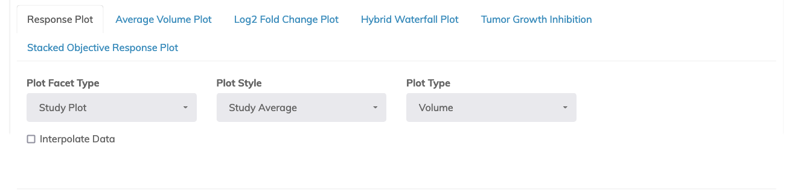

  

A common way to display tumor growth on treatment and control arms are tumor growth curves, which typically displays tumor volumes calculated by the following formula:  

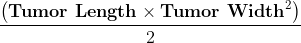

Tumor growth curves in this panel are by default as the 'Study Average' of tumor volume with standard errors. 

* Plots are arranged by 'Study' (default) or 'Treatment' using the 'Plot Facet Type' dropdown.  

* Plots can also be shown by 'Study Average' (default) or 'Individual Animal' using the 'Plot Style' dropdown. 

* Data for all plot combinations / selection can be interpolated with 'Interpolate Data'

* There are four options for 'Plot Type' with that dropdown. The options are:   

---

A. Volume (default)

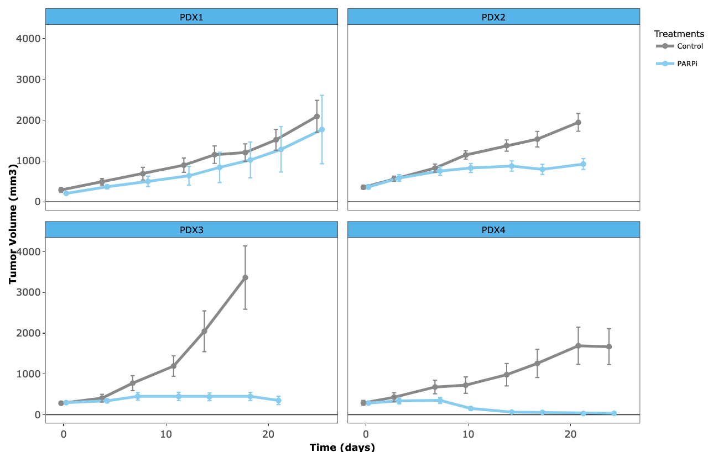

This plot displays tumor volume as provided by the user in the 'Volume' column of the loaded/filtered dataset. It is assumed that this is tumor volume in mm3.

---

B. Scaled  

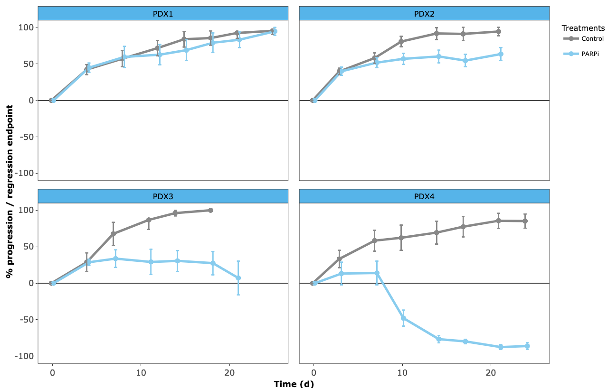

  

This plot re-scales volume data from -100 to 100. Where -100 represents total tumor regression, 0 is neither growth nor regression, and 100 represents when growth has reached a pre-defined end point. 

Users are able to define the endpoint as either a growth factor (e.g., 4x) or volume (e.g., 1200 mm3). When 'Scaled' is selected, the 'Scale Plot By' and 'Endpoint Scaling' options will appear. 

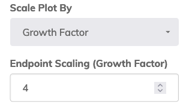

 

---
  
C. Percent Change  

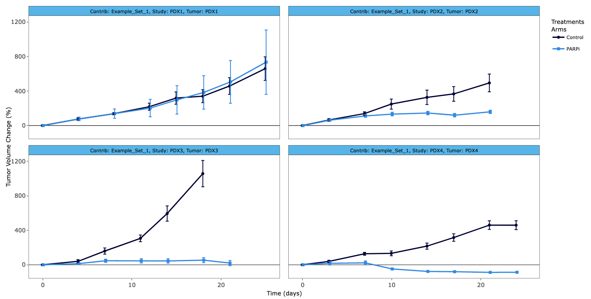

  

This plot shows an alternate way to demonstrate growth curves using percent change in tumor volume. Percent change is defined for each individual within study and treatment arm. It is calculated as follows: 

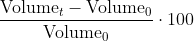

---

D. Log2(Volume)

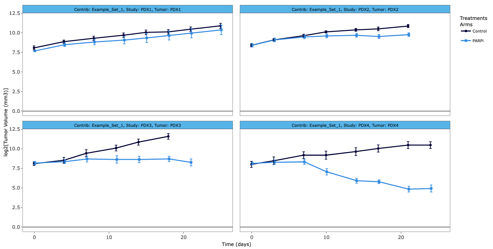

 

This plot show the log2 transformation of volume measures on the y-axis, and study day along the x-axis.

---

D. Log2[Proportion Volume Change]

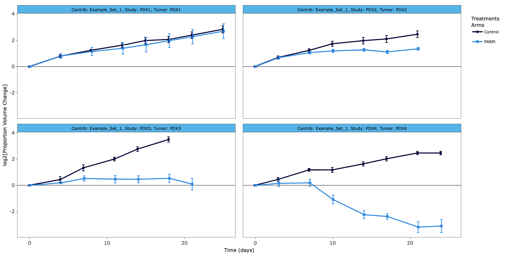

 

This plot show the log2 transformation of the proportion of volume change on the y-axis, and study day along the x-axis.

---

### Average Volume Plot

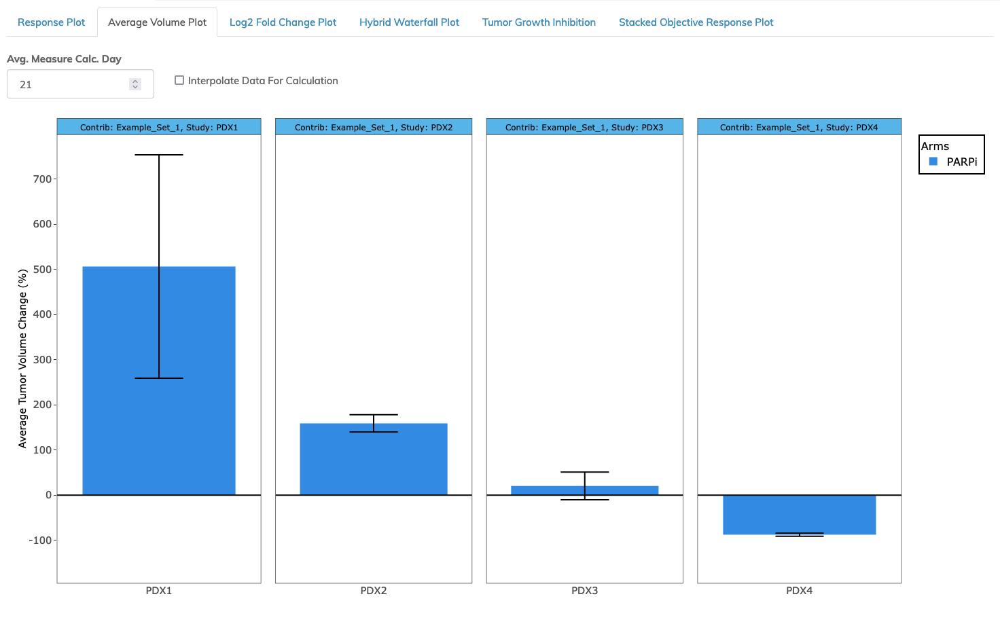

 

This plot shows cross study average volume across all animals for treatment arms +/- SE at a user defined time point (default "Avg Measure Calc. Day" is 21). Data underlying this plot can be interpolated with the checkbox.  

### Log2 Fold Change Plot

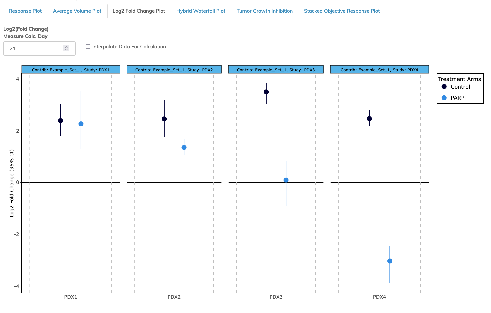

 

This plot shows cross study mean log2 fold change [log2(Volumet / Volumet)] across all animals for treatment arms +/- SE at a user defined time point (default "Log2(Fold Change) Measure Calc. Day" is 21). Data underlying this plot can be interpolated with the checkbox.  

---

### Hybrid Waterfall Plot

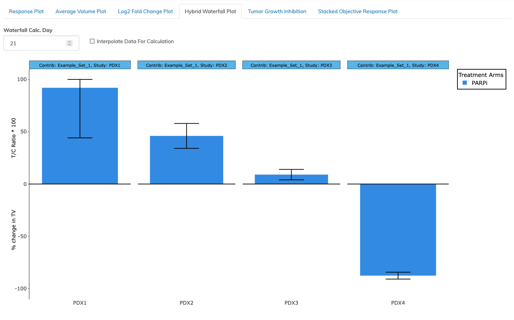

 

This plot shows cross study hybrid waterfall plot. Where model by treatment arm shows progression, T / C ratio +/- SE  is displayed in the plot. T/C is defined within study, tumor, and treatment arm defined roughly as:  

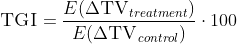

For the specific formulation, see the 'Tumor Growth Inhibition' section that follows. 

Where model by treatment arm shows regression, percent change in tumor volume (as defined above) +/- SE is shown. The calculation of these metrics is taken at the user defined time point (default "Waterfall Calc. Day" is 21). Data underlying this plot can be interpolated with the checkbox.
  

---

### Tumor Growth Inhibition

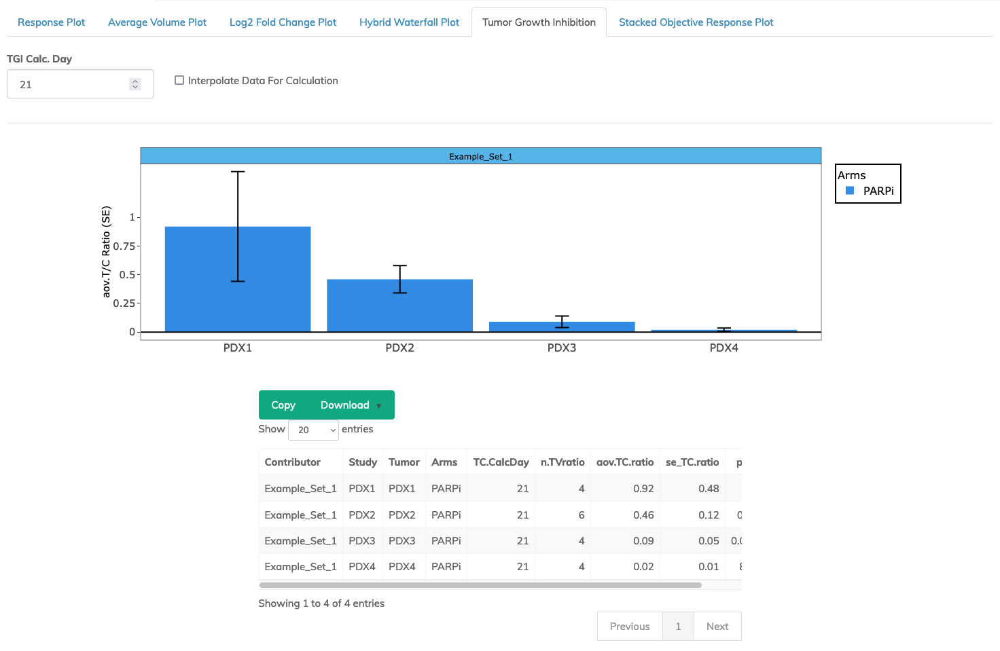

 

This plot and table shows cross study tumor growth inhibition defined as the T/C ratio at the user defined time point (default "TGI Calc. Day" is 21). 

For T/C calculations, tumor volume is linearly interpolated to the selected day when it falls between measurements. Animals without measurements spanning that day, or with a baseline volume at or below zero, are excluded; endpoint volume zero is retained. Fold changes below 0.001 are floored to 0.001 for the log2 model. The arithmetic T/C ratio is the ratio of arm means and uses a delta-method standard error. The ANOVA-derived T/C ratio is estimated on log2 fold changes and its displayed standard error is calculated from the fitted model. T/C p-values are two-sided Tukey-adjusted comparisons against control.

The pairwise table compares every pair of treatment arms on the same log2 fold-change scale. It reports the difference and geometric fold-change ratio with a Tukey-adjusted 95% confidence interval and p-value; the ratio is Arm 1 divided by Arm 2. This includes combination-versus-single-agent contrasts when those arms are present.

The ANOVA-derived T/C ratio follows the log2 fold-change model described in Supplemental Materials 1 of Evrard et al. (2020). The day-specific endpoint is interpolated within each animal's measurement range as described above. The checkbox can additionally interpolate the full time series used by related plots.

 
Briefly, after log transforming the change in tumor volume (as defined above), a linear model is fit:

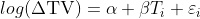

where *Ti* is the treatment arm for each individual. 

If we define TGI as the ratio of mean tumor to mean control as in the equation shown in section 1c. above, it can be shown that:

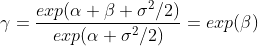

Where TGI < 1 indicates the degree of growth inhibition of the treatment relative to control. To test for the significance of anti-tumor activity of the treatment group at time *t*, we test the null hypothesis of no treatment effect by comparing:

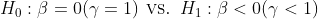

    Evrard YA, Srivastava A, Randjelovic J, Doroshow JH, Dean DA 2nd, Morris JS, Chuang JH; NCI PDXNet Consortium. Systematic Establishment of Robustness and Standards in Patient-Derived Xenograft Experiments and Analysis. Cancer Res. 2020 Jun 1;80(11):2286-2297. doi: 10.1158/0008-5472.CAN-19-3101. Epub 2020 Mar 9. PMID: 32152150; PMCID: PMC7272270.

---

### Stacked ORC Plot

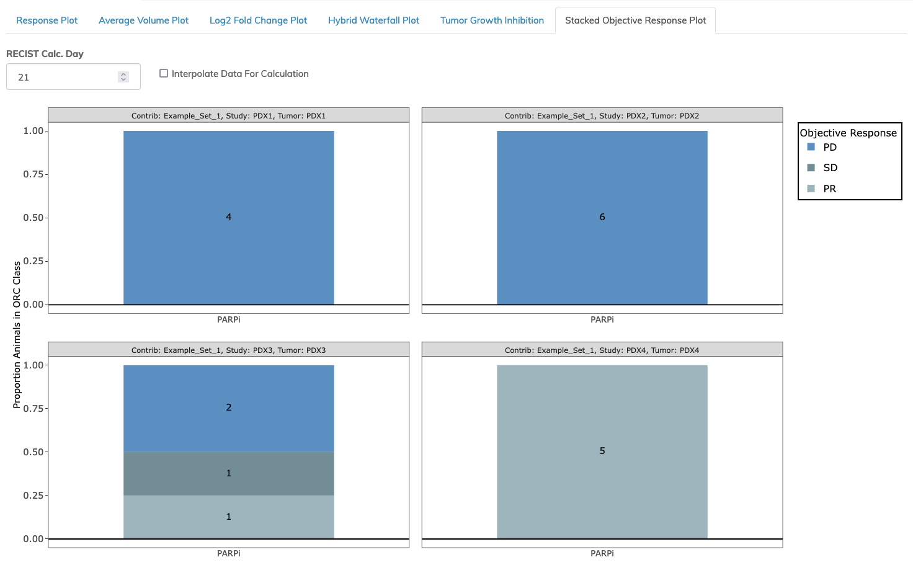

 

This plot summarizes individual animal objective response criteria at the user defined time point (default "RECIST Calc. Day" is 21). Data underlying this plot can be interpolated with the checkbox.  

The classification used mimics RECIST criteria commonly used in clinical trials for solid tumors to classify each patient as complete response (CR), partial response (PR), stable disease (SD), or progressive disease (PD). At a user defined time *t*, each animal was classified into one of these four categories based on their percent tumor volume change from baseline based on the following cut points: 

1. CR : ∆TVt <= -95%
2. PR : -95% < ∆TVt <= -30%
3. SD : -30% < ∆TVt <= 20%
4. PD : All other cases

---

## Individual Study Plots & Analysis

Users select the 'Study' of interest from the study selection dropdown. Four sub-tabs provide access to different visualizations and analysis metrics for analysis of the selected study. 

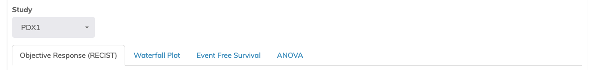

### Objective Response (RECIST)

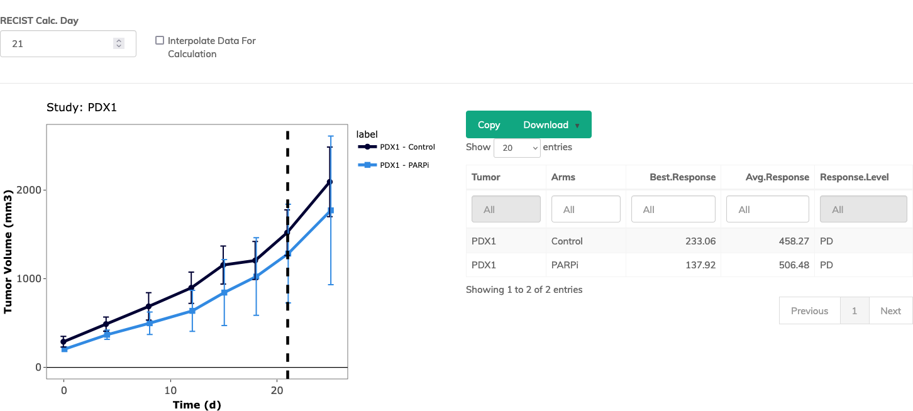

 

This plot and table summarize cohort level objective response criteria at the user defined time point (default "RECIST Calc. Day" is 21). Data underlying this metric can be interpolated with the checkbox.  

The classification used mimics RECIST criteria commonly used in clinical trials for solid tumors to classify each patient as complete response (CR), partial response (PR), stable disease (SD), or progressive disease (PD). This classification differs from the above, in that a RECIST classification is applied to each treatment arm in the following way. 

1. ∆TV for each animal is calculated at time *t*.
2. Within each treatment arm, the minimum ∆TV is found as ∆TVm.
3. Within each treatment arm, the mean ∆TV is computed across replicates as ∆TVa.
3. RECIST category is then determined for each treatment arm as follows:  
    1. CR : ∆TVm <= -95%, and  ∆TVa <= -40%
    2. PR : ∆TVm <= -50%, and  ∆TVa <= -20%
    3. SD : ∆TVm <=  35%, and  ∆TVa <=  30%
    4. PD : All other cases

### Waterfall Plot

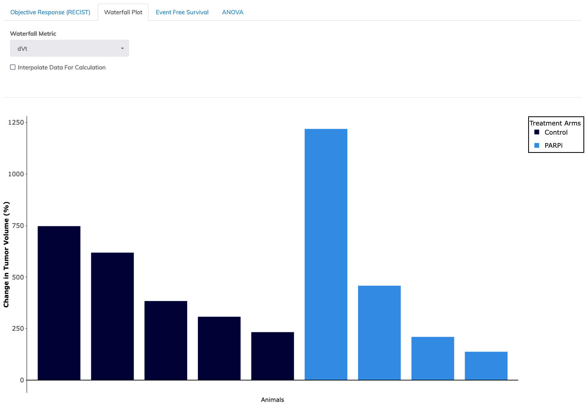

 

Waterfall plots can be shown for individual animals using one of three different metrics selected in the 'Waterfall Metric' dropdown.

1. dVt : percent change in tumor volume. 
2. AUC.All.Measures : Area under the curve for the entire time series. 
3. AUC.Filtered.Measures : Area under the curve for the time series up through the user specified day (default "Final Day for AUC Calc." is 21). Note that "Final Day for AUC Calc." will only be present when AUC.Filtered.Measures is selected. 

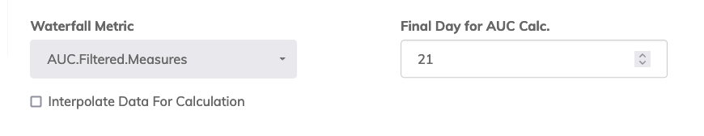

 

Area under the tumor growth curve from baseline up to time *t* (either max time, or user specific time) is normalized by dividing by *t*. With this normalization factor, the interpretation of this measure is the average percent change in tumor size from baseline to time *t*. For area under a spline interpolation was used (`splinefun` function in combination with `integrate` to calculate a numerical integral). All three measures can be computed from interpolated data using the checkbox. 

### Event Free Survival

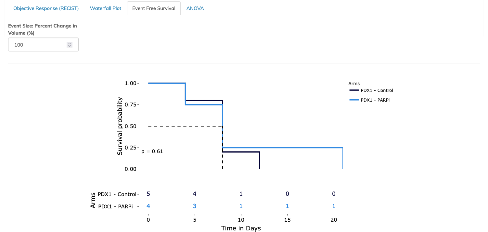

 

Event free survival analysis is conducted based on censoring events which occur when tumor growth exceeds the user defined percent change in volume. By default the "Event Size: Percent Change in Volume" is 100% which represents 2x tumor growth (200% would represents 4x growth etc). EFS is censored at the last measurement for animals whose tumors do not reach the defined threshold. The survival curve estimates and significance for the censored data is computed using the Kaplan-Meier method in the `survfit` package. Median survival is shown as a dotted line. Data underlying this metric/plot can be interpolated with the checkbox.

---

### ANOVA

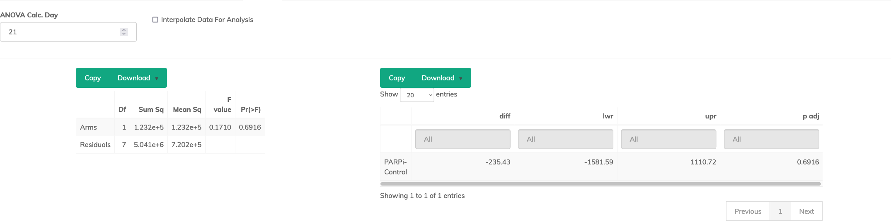

 

The difference in tumor volumes among treatment arms at a user defined day can be compared using one-way ANOVA. By default ANOVA Calc. Day is 21 days. Endpoint volumes are linearly interpolated to this day when measurements span it; zero endpoint volumes are retained and animals with baseline volume at or below zero are excluded. If fewer than 2 groups remain, select a different time point. Tukey's test reports adjusted pairwise comparisons among all treatment arms.

### Factorial Interaction

The Factorial Interaction tab uses the optional `Treatment_Components` column to discover any number of agents. Select the agents to include, the calculation day, and the highest interaction order. Arms containing unselected agents are excluded from that selected-agent model. The response is each eligible animal's log2 fold change from baseline, with fold changes below 0.001 (including zero) floored to 0.001 before log transformation. A nested F-test compares the selected model, including main effects and interactions through the chosen order, with a main-effects-only model. Individual interaction terms have coefficient estimates, model-based 95% confidence intervals, and Holm-adjusted p-values within each cohort.

The analysis is fit separately within each Contributor, Study, and Tumor cohort and is not pooled across cohorts. It requires a `Control` arm with an empty component list, consistent component metadata for each arm, positive baseline measurements, and enough observed treatment combinations and replication to estimate the selected terms. A complete factorial design is needed to estimate all terms without aliasing; rank-deficient interaction terms are reported as non-estimable. Cohort exclusions are listed in the diagnostics. The joint test is a test of interaction on the log2 fold-change scale, not a universal synergy score; interpretation depends on the selected response scale and design.

---

## Body Weight Analysis

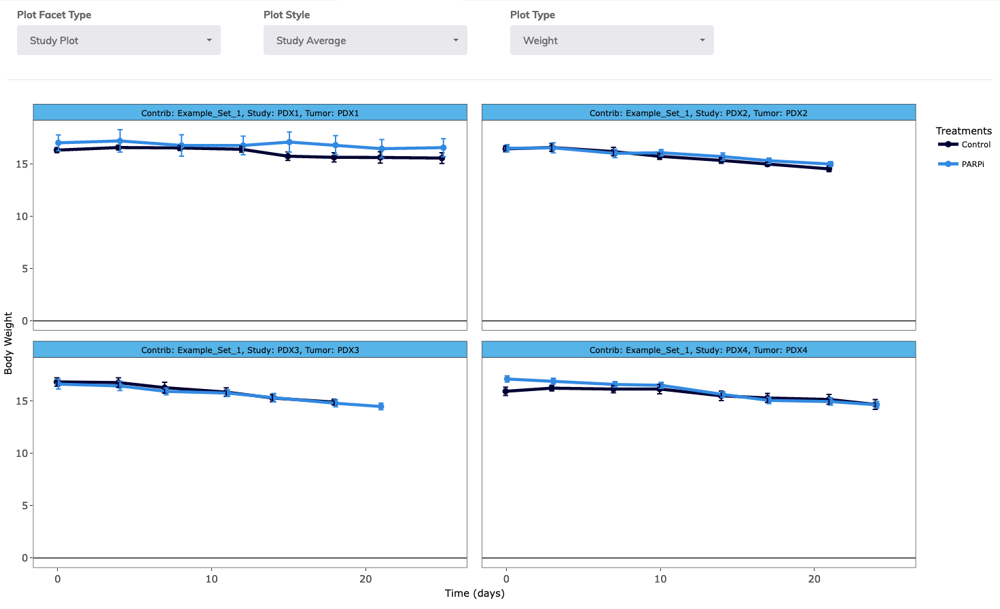

 

PDX experiments should include monitoring of body weight and overall health as toxicity analogs. Antitumor activity is only clinically relevant if it can be achieved without substantial toxicity.

When provided with body weight data, users can select the 'Body Weight Analysis' tab to display body eight plots. Body weight curves in this panel are by default as the 'Study Average' of weight with standard errors. 

* Plots are arranged by 'Study' (default) or 'Treatment' using the 'Plot Facet Type' dropdown.  

* Plots can also be shown by 'Study Average' (default) or 'Individual Animal' using the 'Plot Style' dropdown. 

* Data for all plot combinations / selection can be interpolated with 'Interpolate Data'

* There are two options for 'Plot Type' with that dropdown. The options are:   

---

A. Weight (default)

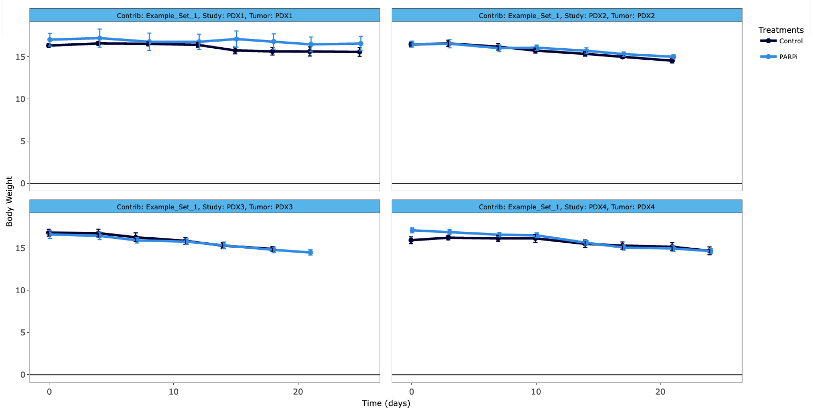

This plot displays body weight as provided by the user in 'Body_Weight' column of the loaded/filtered dataset. 

----

B. Percent Change  

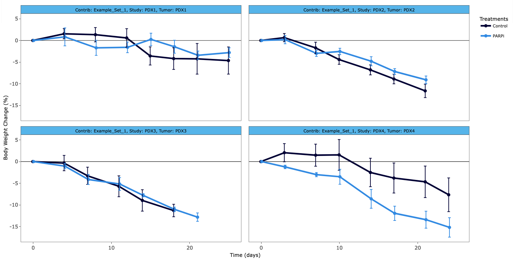

  

This plot shows an alternate way to demonstrate body weight curves using percent change in body weight. Percent change is defined for each individual within study and treatment arm. It is calculated as in percent tumor volume change, but using weights rather than volumes.  

## Current Data Table

Shows the currently filtered data table. This table can be copied to your clipboard, or downloaded if required. 
